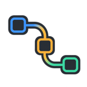
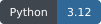
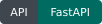
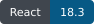
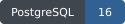
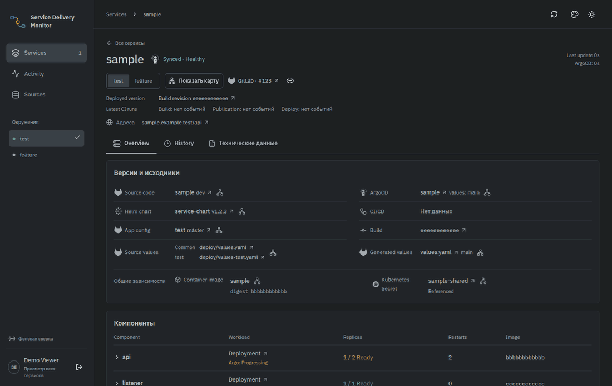
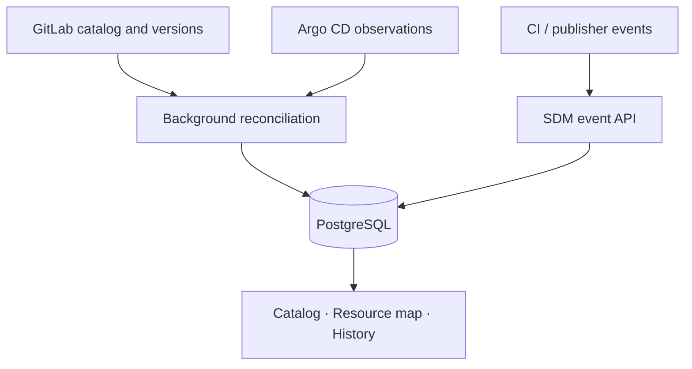

<p align="center"></p>
<h1 align="center">Service Delivery Monitor</h1>
<p align="center">Trace a service from source and build to desired state and observed runtime.</p>
<p align="center">
  
  
  
  
  
</p>

SDM brings source revisions, CI attempts, published values, Argo CD observations and runtime images into one service catalog. Use the resource map and history to find what was built, what was requested and what is actually observed.

## See it in use



The recording uses the real desktop frontend with synthetic service metadata. [Static screenshot](assets/readme/screenshot.png) · [Reproduce the demo](docs/demo.md)

## Run locally

Docker with Compose is required:

```sh
git clone https://github.com/ArtefactoO/service-delivery-monitor.git
cd service-delivery-monitor
docker compose up --build -d
```

The app listens at **http://localhost:4318**. Check readiness at `/readyz` and read the local catalog without printing its token:

```sh
docker compose exec -T app python local-read.py
```

The default stack has no OIDC provider, so the browser shows the sign-in screen. Configure [OIDC over HTTPS](docs/access.md) to use the UI with a real backend. The demo above records synthetic UI fixtures separately.

Local machine tokens are generated in container tmpfs. External collectors are disabled. The catalog starts from `backend/config/registry.example.json`, without live deployment observations.

```sh
docker compose --profile test build test
docker compose --profile test run --rm test
docker compose --profile test stop db-test
```

Stop with `docker compose down`. PostgreSQL data remains in its Docker volume. [Configure real sources](docs/catalog-source.md) and [authentication](docs/access.md) before using a shared environment.

## Read each signal on its own terms

| Signal | What it establishes |
| --- | --- |
| Source | A repository, ref and commit |
| Build | A CI attempt and image digest |
| Publication | The chart and generated values requested for an environment |
| Argo CD | The Application's reported Sync and Health |
| Runtime | Observed images, readiness and restart counts |

A successful build does not establish a successful rollout. Unknown values stay unknown. A stale observation keeps its original status and is marked with its age.

SDM reads saved observations through its backend API. Browser refresh does not trigger a fresh upstream collection. It does not deploy applications, sync Argo CD or access Kubernetes directly.

## Integration scope

The current collectors and CI identity endpoint support **GitLab and Argo CD**. Hosting this repository on GitHub does not add a GitHub Actions delivery collector. Other producers can submit normalized events through the scoped bearer-token API.

The catalog collector expects the documented publisher allowlist and generated-values contract. It is not an automatic inventory of arbitrary GitOps repositories. The interface targets desktop screens.



## Development

```sh
docker build --target frontend -t sdm-frontend -f deploy/Dockerfile .
docker run --rm sdm-frontend pnpm test:graph
```

Gitleaks runs automatically on pull requests and pushes to `main`. Frontend builds and graph tests, backend tests against disposable PostgreSQL and test-image builds run only through **Actions → CI → Run workflow**. The workflow does not publish images or deploy a cluster.

## Documentation

Documentation is in English. Some interface labels are currently in Russian.

| Task | Guide |
| --- | --- |
| Understand the model and collection budget | [Architecture](docs/architecture.md) |
| Inspect the UI and graph semantics | [User guide](docs/user-guide.md), [edge semantics](docs/edge-semantics.md) |
| Submit events | [Event contract](docs/events.md), [JSON Schema](docs/event.schema.json) |
| Configure source repositories | [Catalog contract](docs/catalog-source.md) |
| Configure SSO and producer identities | [Access](docs/access.md) |
| Deploy the service | [Deployment](docs/delivery.md) |

See [CONTRIBUTING.md](CONTRIBUTING.md) and [SECURITY.md](SECURITY.md).

## License

Original project code is licensed under the [MIT License](LICENSE). Third-party dependencies and assets retain their own licenses and notices.
